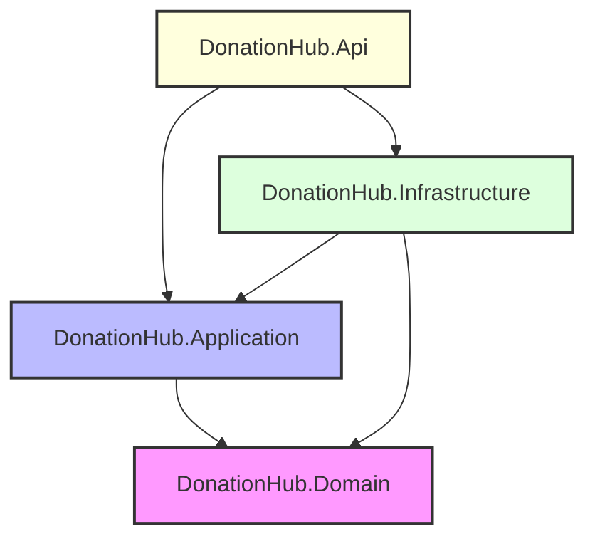

# DonationHub - Humanitarian Crowdfunding Platform (.NET 10)

[](https://dotnet.microsoft.com/)
[](https://www.nuget.org/packages/Microsoft.EntityFrameworkCore)
[](https://learn.microsoft.com/en-us/dotnet/architecture/modern-web-apps-azure/common-web-application-architectures)
[](https://scalar.com)
[](https://tawjeh.net)

DonationHub is an enterprise-grade crowdfunding platform designed for humanitarian relief campaigns, built with modern **.NET 10**, **C# 13/14**, **Entity Framework Core 10**, and **SQL Server**. The solution strictly adheres to **Clean Architecture** principles and **Vertical Slices**, enforcing a rich domain model with 10 business invariants, robust identity and security mechanisms (JWT + Refresh Token rotation), soft-delete interceptors, fail-fast options validation, and interactive API documentation powered by **Scalar** and **OpenAPI**.

---

## 🏛️ Clean Architecture & Layer Organization

The solution strictly isolates responsibilities across 4 discrete layers with unidirectional dependencies:



### Layer Details:
1. **`DonationHub.Domain` (Core / Zero Dependencies)**
   - Enterprise entities (`Campaign`, `Donation`, `User`, `Category`, `AuditLog`, `Organization`, `CampaignUpdate`, `RefreshToken`).
   - Enums (`Role`, `CampaignStatus`, `DonationStatus`).
   - Value Objects (`Money`).
   - Pure business invariants enforced with private setters and expressive domain methods.
   - Zero external library dependencies (no EF Core, no ASP.NET Core).

2. **`DonationHub.Application` (Business Logic & Vertical Slices)**
   - Slices organized by feature: `Features/Auth`, `Features/Categories`, `Features/Users`, `Features/Campaigns`.
   - Interfaces for abstractions: `IAppDbContext`, `IGenericRepository<T>`, `IUnitOfWork`, `IPasswordHasher`, `ITokenService`, `ICategoryService`.
   - DTOs and Request/Response contracts.
   - Strongly-typed Options classes (`JwtOptions`, `SeedAdminOptions`, `DonationOptions`).
   - Domain and Business Exceptions.

3. **`DonationHub.Infrastructure` (Data Persistence & External Services)**
   - EF Core `AppDbContext` and Fluent API Entity Type Configurations.
   - `DeleteBehavior.Restrict` configured on critical relationships to prevent accidental cascades.
   - Concurrency token (`Campaign.RowVersion` / `IsRowVersion()`) for optimistic locking.
   - `SoftDeleteInterceptor` automatically setting `IsDeleted = true` and `DeletedAtUtc`.
   - Security implementations: PBKDF2 password hashing with salt, cryptographically secure random token generation, SHA-256 refresh token hashing.
   - Unit of Work and Generic Repository implementation with transaction coordination.

4. **`DonationHub.Api` (Presentation & HTTP Runtime)**
   - Thin ASP.NET Core Web API controllers (`AuthController`, `AdminController`, `CategoriesController`).
   - Scalar API Reference integration (`MapScalarApiReference`) with Bearer Security Scheme Transformer (`IOpenApiDocumentTransformer`).
   - Fail-fast Options pattern (`ValidateDataAnnotations()`, `ValidateOnStart()`).
   - Database migration and startup seeding extensions (`SeedAdminUserAsync`, `SeedDefaultCategoriesAsync`).

---

## 🚀 Key Technologies & Tooling

| Technology | Purpose |
| :--- | :--- |
| **.NET 10 SDK** | Runtime and base framework (C# 13/14 language features) |
| **EF Core 10** | Object-Relational Mapping (ORM) and Migrations |
| **SQL Server / LocalDB** | Relational Database persistence |
| **Scalar.AspNetCore** | Modern, interactive API reference documentation |
| **Microsoft.AspNetCore.OpenApi** | Native OpenAPI 3.1 document generation (.NET 10) |
| **Central Package Management (CPM)** | Managed package versions via `Directory.Packages.props` |
| **SolutionX (`DonationHub.slnx`)** | Modern, lightweight XML solution format |
| **Secret Manager (`dotnet user-secrets`)** | Zero-secrets-in-git compliance |

---

## ⚙️ Prerequisites & Setup

### 1. Requirements:
- [.NET 10 SDK](https://dotnet.microsoft.com/download/dotnet/10.0) (Version 10.0.100+)
- [SQL Server](https://www.microsoft.com/sql-server) or **SQL Server LocalDB** (included with Visual Studio)

### 2. Clone the Repository:
```bash
git clone https://github.com/AhmedEmadhammmad/-DonationHub.git
cd -DonationHub/Sprint1
```

### 3. Restore & Build:
```bash
dotnet restore DonationHub.slnx
dotnet build --no-restore DonationHub.slnx
```

---

## 🔐 Configuration & Secrets (Zero Secrets in Git)

In compliance with strict security guardrails, **no secrets or production credentials exist in `appsettings.json`**. All sensitive configurations are managed via .NET Secret Manager or Environment Variables:

Navigate to `src/DonationHub.Api` and configure user secrets:

```bash
cd src/DonationHub.Api

# 1. Connection String to SQL Server LocalDB
dotnet user-secrets set "ConnectionStrings:DefaultConnection" "Server=(localdb)\\mssqllocaldb;Database=DonationHubDb;Trusted_Connection=True;MultipleActiveResultSets=true;TrustServerCertificate=True"

# 2. JWT Authentication Secrets (SecretKey must be at least 32 characters)
dotnet user-secrets set "JwtOptions:SecretKey" "DonationHub_Super_Secret_Key_Sprint1_2026_Minimum_32_Characters!"
dotnet user-secrets set "JwtOptions:Issuer" "DonationHub"
dotnet user-secrets set "JwtOptions:Audience" "DonationHubClient"
dotnet user-secrets set "JwtOptions:AccessTokenExpirationMinutes" "15"
dotnet user-secrets set "JwtOptions:RefreshTokenExpirationDays" "7"

# 3. Initial Administrator Seed Credentials
dotnet user-secrets set "SeedAdminOptions:Email" "admin@donationhub.org"
dotnet user-secrets set "SeedAdminOptions:Password" "Admin@123456!"
dotnet user-secrets set "SeedAdminOptions:FullName" "System Administrator"

# 4. Global Donation Business Boundaries
dotnet user-secrets set "DonationOptions:MinDonationAmount" "5"
dotnet user-secrets set "DonationOptions:MaxDonationAmount" "100000"
```

---

## 🗄️ Database Migrations & Seeding

### 1. Apply Migrations:
To apply the database schema to your local SQL Server instance:
```bash
dotnet ef database update --project src/DonationHub.Infrastructure --startup-project src/DonationHub.Api
```

### 2. Automatic Seeding on Startup:
When the application starts, it automatically executes two seeding routines:
- **Default Administrator Account:** Seeds `admin@donationhub.org` with role `Admin` if not already present.
- **5 Default Bilingual Categories:** Seeds 5 core humanitarian categories:
  1. Health (صحة)
  2. Education (تعليم)
  3. Relief (إغاثة)
  4. Orphans (أيتام)
  5. Environment (بيئة)

---

## 📖 API Documentation & Testing (Scalar UI)

The project uses **Scalar** for interactive API documentation and testing.

### 1. Launch the API:
```bash
cd src/DonationHub.Api
dotnet run --launch-profile https
```

### 2. Access Scalar:
Open your browser and navigate to:
- **`https://localhost:7259/`** (automatically redirects to `/scalar/v1`)
- Or directly: **`https://localhost:7259/scalar/v1`**
- Raw OpenAPI document: **`https://localhost:7259/openapi/v1.json`**

### 3. How to Authenticate in Scalar UI:
1. In Scalar, navigate to **`POST /api/v1/auth/login`**.
2. Send the login request with the Admin credentials:
   ```json
   {
     "email": "admin@donationhub.org",
     "password": "Admin@123456!"
   }
   ```
3. Copy the returned `accessToken`.
4. Click the **"Authorize"** button in Scalar UI (top bar or next to protected endpoints).
5. Paste your token under **Bearer Authentication**.
6. All subsequent requests to protected endpoints (e.g. `GET /api/v1/auth/me`, `POST /api/v1/categories`, `POST /api/v1/admin/staff`) will automatically include `Authorization: Bearer <token>`.

---

## 🛡️ Core Architectural Decisions & Trade-Offs (Oral Defense Guide)

The following architectural decisions are deliberately designed to ensure high performance, security, and scalability:

### 1. Command-Query Separation (CQS)
- **Writes:** Coordinated through `IGenericRepository<T>` and `IUnitOfWork`. Enforces ACID transaction boundaries, tracks entity state changes, and validates business invariants prior to commit.
- **Reads:** Direct DbContext projection with `.AsNoTracking()` to DTOs. Bypasses entity change tracking overhead and snapshot allocation, achieving maximum read throughput and lower garbage collection (GC) pressure.

### 2. Rich Domain Model vs. Anemic Domain Model
- All domain rules and invariants are encapsulated within domain entities (`Campaign`, `Donation`, `User`, `Category`).
- All entity property setters are `private` or `protected`.
- Entities can only be mutated through explicit, business-meaningful methods (`Activate()`, `ReceiveDonation()`, `Cancel()`, etc.).
- Value Objects (`Money`) encapsulate amount and currency validation, preventing invalid state instantiation anywhere in the system.

### 3. SHA-256 Hashed Refresh Tokens & Replay Defense
- Refresh tokens are never stored in plaintext in the database.
- A raw cryptographic random string is issued to the client, while its **SHA-256 hash** is stored in SQL Server.
- **Token Family Rotation:** Each refresh token can only be used once. If an already-revoked or expired refresh token is presented (potential token theft/replay attack), the entire token chain for that user is immediately revoked.

### 4. Soft Delete Interceptor vs. Repository Filtering
- Implemented via `ISoftDeletable` and an EF Core `SaveChangesInterceptor` (`SoftDeleteInterceptor`).
- Automatically intercepts `EntityState.Deleted` and converts it into `IsDeleted = true` and `DeletedAtUtc = DateTime.UtcNow`.
- Combined with EF Core **Global Query Filters** (`builder.HasQueryFilter(e => !e.IsDeleted)`), ensuring developers never accidentally leak soft-deleted records across any query in the system.

### 5. Invariant 10: Referential Integrity on Category Deletion
- A category cannot be deleted if any campaigns are linked to it.
- To protect historical audit trails and referential integrity even with soft-deleted campaigns, the validation query explicitly calls `.IgnoreQueryFilters()`:
  ```csharp
  var hasCampaigns = await _dbContext.Campaigns
      .IgnoreQueryFilters()
      .AnyAsync(c => c.CategoryId == id, cancellationToken);
  ```
  If campaigns exist, it returns `409 Conflict` with error code `Category.HasCampaigns`.

### 6. Fail-Fast Options Validation
- Registered options (`JwtOptions`, `SeedAdminOptions`, `DonationOptions`) use `.ValidateDataAnnotations()` and `.ValidateOnStart()`.
- If an essential secret or misconfigured value is missing, the application fails immediately during container initialization (`IHost.Start()`), preventing broken or insecure containers from accepting traffic in production.

### 7. Asynchronous I/O & Service Lifetimes
- `AppDbContext` is registered as **Scoped**; never Singleton.
- Wrapping EF Core asynchronous calls in `Task.Run` is strictly prohibited. The system relies entirely on native asynchronous I/O completion ports (IOCP) to avoid thread pool starvation and maximize throughput under load.

---

## 📡 API Endpoints Reference

### 🔐 Authentication & Identity (`/api/v1/auth`)
| Method | Endpoint | Authorization | Description |
| :--- | :--- | :--- | :--- |
| `POST` | `/api/v1/auth/register` | Anonymous | Register a new Donor account |
| `POST` | `/api/v1/auth/login` | Anonymous | Authenticate and obtain Access & Refresh tokens |
| `POST` | `/api/v1/auth/refresh` | Anonymous | Rotate Refresh token and obtain new Access token |
| `POST` | `/api/v1/auth/revoke` | Anonymous | Revoke an active Refresh token |
| `GET` | `/api/v1/auth/me` | Authenticated | Retrieve profile details of authenticated user |

### 👑 Administration (`/api/v1/admin`)
| Method | Endpoint | Authorization | Description |
| :--- | :--- | :--- | :--- |
| `POST` | `/api/v1/admin/staff` | `Role: Admin` | Provision a new Staff member account |

### 📂 Categories (`/api/v1/categories`)
| Method | Endpoint | Authorization | Description |
| :--- | :--- | :--- | :--- |
| `GET` | `/api/v1/categories` | Anonymous | Retrieve all active categories (Bilingual) |
| `GET` | `/api/v1/categories/{id}` | Anonymous | Retrieve a specific category by ID |
| `POST` | `/api/v1/categories` | `Role: Admin` | Create a new category (Enforces unique names) |
| `PUT` | `/api/v1/categories/{id}` | `Role: Admin` | Update an existing category |
| `DELETE` | `/api/v1/categories/{id}` | `Role: Admin` | Soft-delete a category (Guarded by Invariant 10) |

---

## 🧪 Smoke Tests

The solution passes standard .NET build and smoke test execution:
```bash
dotnet test DonationHub.slnx
```

---

## 🏷️ Sprint Submission Note

- **Sprint:** Sprint 1 - DonationHub Foundation
- **Git Submission Protocol:** Delivery tag `sprint-1`.
- **Commit History:** Follows [Conventional Commits](https://www.conventionalcommits.org/) standards.
